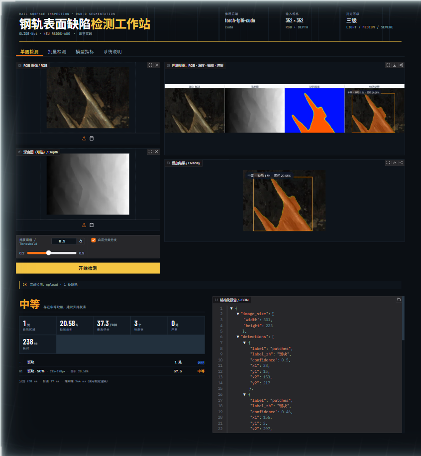

# 文档索引 · 钢轨表面缺陷检测系统（GLIDE-Net 课程实践）

本目录是课程实践的**交付文档**。所有数字都能追溯到一条命令和一份机器可读结果
（`docs/assets/*.csv|json`），图表由脚本生成，不手工修饰。

```
docs/
├── README.md            你在这里：索引、术语表、三条最短上手路径
├── features.md          功能说明：界面四个 Tab、15 个 CLI、库级接口、错误边界
├── team.md              7 人分工（A–G）、交付物、协作与验收口径
├── architecture.md      系统架构、模块职责、接口契约、模型内部结构
├── dataset.md           数据集来源、统计、预处理一致性核对
├── evaluation.md        分割复现、与 11 种方法对比、消融、系统级评测
├── severity.md          缺陷严重程度分级规则与标定过程
├── deployment.md        ONNX 导出、TensorRT 尝试、后端选择与保真度
├── experiment-log.md    全程实验日志：命令、现象、问题、解决
├── acceptance.md        验收清单（功能 10 + 指标 8 + 部署 6 + 工程 10 = 34 项）与自检命令
├── presentation.md      课堂汇报提纲、演示脚本、预期提问
└── assets/              架构图（drawio + png）、图表、评测结果表
```



> 实机截图（Chrome 1920×928，`python -m app.main --port 7861`），
> 由 kimi-webbridge 会话 `defect-ui-check` 截取。单图检测 Tab：左列上传区 + 阈值滑块，
> 右列四联视图与叠加结果，下方报告卡与结构化 JSON。

## 三条最短上手路径

**1. 只想看结论** → 读 [evaluation.md](evaluation.md) 的四张表，再看
`docs/assets/comparison-bars.png`、`ablation-bars.png`。

**2. 想跑起来** → 

```bash
conda activate base           # Python 3.12 + torch 2.5.1+cu121 + CUDA 可用
pip install -r requirements.txt

# 复现论文指标（362 张测试图，约 3 分钟）
python test.py --data_path ../datasets/NEU-RSDDS-AUG --checkpoint ckpt/glide_net_6440647.pth \
    --save_path results/pred
python eval.py --pred_path results/pred --gt_path ../datasets/NEU-RSDDS-AUG/GT_test

# 启动检测工作站（浏览器打开 7860）
python -m app.main --checkpoint ckpt/glide_net_6440647.pth \
    --detector runs/detect/detection/runs/neudet_yolov8m/weights/best.pt
```

**3. 想改东西** → 先读 [architecture.md](architecture.md) 的“模块边界”一节，
每个模块只有一个职责，改分级规则只动 `app/engines/severity.py`。
想看“哪个按钮/命令能干什么、参数是什么” → [features.md](features.md)。

## 术语表

| 术语 | 含义 |
|------|------|
| RGB-D | 彩色 + 深度双模态输入（本项目的深度图为 16 位 TIFF） |
| GLIDE-Net | 分割主干：冻结 SAM2-Hiera + 可训练 ConvNeXt 双流 CNN + CMF + MSDEF |
| CMF | Cross-Modal Fusion，通道增强 CE + 空间增强 SE，融合 RGB 与深度特征 |
| MSDEF | Multi-Scale Detail Enhancement and Fusion，解码器（含 WD 权重分配器与 DEU 细节增强单元） |
| S-measure / maxF / maxE / MAE | 显著目标检测标准指标，衡量掩膜与真值的一致性 |
| 掩膜（mask） | 逐像素的二值缺陷区域，本系统在 352×352 上推理后缩放到原图尺寸 |
| 判定（verdict） | 图像级结论：`none` / `light` / `medium` / `severe` |
| 区域评分 | 0–100 的缺陷严重程度分数，26、55 为分档阈值 |
| NEU RSDDS-AUG | 分割数据集，1 862 张 RGB-D 钢轨表面图像，带像素级真值 |
| NEU-DET | 检测数据集，1 797 张热轧带钢表面图像，6 类缺陷，带边界框 |

## 数据与权重的存放约定

大文件**不进 git**（见根目录 `.gitignore`）：

| 路径 | 内容 | 大小 | 获取方式 |
|------|------|------|----------|
| `ckpt/` | GLIDE-Net 权重（含冻结 SAM2 主干） | 924 MB | 论文仓库百度网盘，见根 README |
| `materials/` | 论文稿件与原始插图 | 8.5 MB | 课程提供 |
| `runs/` | YOLOv8 训练过程与权重 | ~500 MB | `detection/scripts/train_yolo.py` 生成 |
| `deploy/onnx/` | 导出的 ONNX 图与 TRT 缓存 | 1.4 GB | `python deploy/export_onnx.py` |
| `../datasets/NEU-RSDDS-AUG` | 分割数据集 | — | [官方 RSDDS 仓库](https://github.com/neu-rail-rsdds/rsdds) |
| `../datasets/NEU-DET` | 检测数据集 | — | `python tools/download_neudet.py` |

## 结果文件一览

| 文件 | 生成命令 | 内容 |
|------|----------|------|
| `predictions/metrics.csv` | `tools/evaluate_predictions.py` | 12 种方法的 7 项指标 |
| `ablation/metrics.csv` | 同上（`--pred_root ablation`） | 4 组消融变体 |
| `docs/assets/system-eval.json` | `tools/eval_system.py` | 端到端流水线（362 张）：IoU/Dice/延迟/判定分布 |
| `docs/assets/latency.json` | `deploy/benchmark.py` | 四种后端的延迟 + 相对 fp32 的保真度 |
| `docs/assets/detection-metrics.json` | `detection/scripts/report_val.py` | YOLOv8 六类检测指标 |
| `docs/assets/batch-summary.json` | `python -m app.batch` + 汇总 | 100 张批量实测结果 |
| `docs/assets/pr-metrics.csv` | `tools/make_pr_curve.py` | 各方法的 max-F / AP |
| `docs/assets/example-*.png` | `tools/make_examples.py` | 真实流水线渲染的四联图/叠加图 |
| 自检汇总 | `python tools/verify.py` | 34 项验收项的可执行核对 |
| `docs/assets/*.png` | `tools/make_charts.py` / `tools/make_diagrams.py` | 报告与 PPT 用图表 |

## 文档撰写约定

1. **数字必须可复现**：正文出现的每个指标都要标明来源文件。
2. **失败也记录**：尝试过但放弃的方案写在 `experiment-log.md`，注明原因和证据。
3. **图由脚本生成**：`docs/assets/*.drawio` 是源文件，`*.png` 是导出产物，改图改脚本。
4. **单一事实来源**：分级阈值只在 `app/engines/severity.py` 定义一次，文档引用它而不复制数字。
