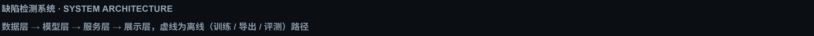
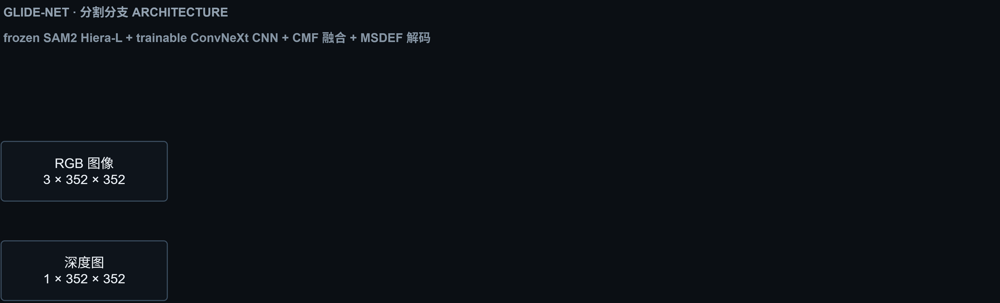

# 系统架构



> 图源：`docs/assets/system-architecture.drawio`，由 `python tools/make_diagrams.py --export` 生成。
> 实线＝在线推理路径，虚线＝离线训练 / 导出 / 评测路径。

## 1. 分层与职责

| 层 | 目录 | 职责 | 不该做的事 |
|----|------|------|------------|
| 数据层 | `dataset.py`、`tools/download_neudet.py` | 配对 RGB/深度/真值、归一化、增强、下载与校验 | 不做后处理、不写指标 |
| 模型层 | `glide_net/`（分割）、`detection/`（检测） | 纯张量进、纯张量出 | 不读文件、不决定分级 |
| 服务层 | `app/engines/` | 预处理、推理封装、双分支融合、分级、报告结构 | 不渲染 UI、不碰 Gradio |
| 展示层 | `app/main.py`、`app/ui/`、`app/viz.py` | 交互、渲染叠加图/四联图、导出 CSV | 不含业务规则 |

**单一契约**：`InspectionReport.as_dict()` 是唯一的数据交换格式。API、批量 CSV、
Gradio 的 JSON 面板、评测脚本读的都是它的字段，因此不存在“界面显示和 CSV 不一致”。

```python
{
  "image_size": {"width": 301, "height": 223},
  "detections": [{"label": "patches", "label_zh": "斑块", "confidence": 0.87,
                  "x1": .., "y1": .., "x2": .., "y2": ..}],
  "regions":    [{"x": .., "y": .., "w": .., "h": .., "area_ratio": 0.21,
                  "elongation": 1.4, "mean_conf": 0.93, "score": 78.4,
                  "severity": "severe", "label": "patches", "label_conf": 0.87}],
  "summary":    {"verdict": "severe", "defect_count": 1, "detection_count": 1,
                 "severity_counts": {"light": 0, "medium": 0, "severe": 1},
                 "classes": {"斑块": 1}, "defect_area_ratio": 0.20576,
                 "worst_score": 99.6},
  "timings":    {"segment_ms": 108.8, "detect_ms": 80.6, "total_ms": 196.2}
}
```

## 2. 分割分支：GLIDE-Net



> 图源：`docs/assets/glide-net-architecture.drawio`；蓝色＝冻结、黄色＝可训练、
> 绿色＝融合、红色＝解码与损失。

### 2.1 混合编码器（`glide_net/modules/encoder.py`）

| 支路 | 结构 | 参数量 | 训练状态 |
|------|------|--------|----------|
| Transformer | SAM2 Hiera-L `image_encoder.trunk`，44 个 block | 213.86 M | **冻结** |
| ↳ Adapter | 每个 block 前插 `Linear(d→32)→GELU→Linear(32→d)→GELU` 残差 | 1.71 M | 可训练 |
| CNN-RGB | 7×7 stem(stride 2) + 3 stage × 2 个 ConvNeXt block | 8.96 M | 可训练 |
| CNN-Depth | 同上，输入 1 通道 | 8.94 M | 可训练 |
| CMF ×3 | 每级通道增强 + 空间增强 | 2.61 M | 可训练 |
| MSDEF 解码器 | WD + DEU + 三次 DoubleConv + 三个输出头 | 7.68 M | 可训练 |
| **合计** | | **242.06 M（可训练 29.91 M，12.4%）** | |

> 复现命令：`python -c "import sys;sys.path.insert(0,'.');..."`，见
> `docs/experiment-log.md` 的“参数量统计”条目。

输出四个尺度：`x1..x4 = [144, 288, 576, 1152]`；CNN 输出 `r1..r3`、`d1..d3`，
在通道数上与 `x1..x3` 对齐（空间尺寸不一致时双线性插值对齐）。

**设计取舍**：全量微调 Hiera 需要 12.26 GB 显存（bs=4，实测），本机 8 GB 装不下；
冻结主干 + adapter 后只需 29.9 M 可训练参数（全模型 242.06 M 的 12.4%），
在不牺牲精度的前提下把训练拉进单卡可承受范围。

### 2.2 跨模态融合 CMF（`glide_net/modules/cmf.py`）

在 1–3 级各放一个 CMF，输入是拼接后的 RGB 特征与深度特征（planes 288/576/1152）：

```
CE  = σ(MLP(GMP([F_rgb, F_d]))) ⊙ F_d        # 通道增强：深度特征按通道重加权
SE  = σ(Conv7×7(Max_c(CE)))                   # 空间增强：按空间位置重加权
out = F_d ⊙ SE + F_rgb                        # 与 RGB 特征相加（非拼接）
```

注意实现里 CE 与 SE 的门控都乘在**深度**特征上，RGB 只做残差加——即“深度补细节、
RGB 定结构”，这也是消融中去掉 CMF 只掉 0.0056 S-measure、但去掉 Transformer 崩到
0.7096 的原因：结构信息来自 Hiera，深度只是增益项。

### 2.3 MSDEF 解码器（`glide_net/modules/msdef.py`、`decoder.py`）

三级解码，每级用 `MultiScaleDetailEnhanceFusion` 替换常规跳连：

```
DEU(x) = x ⊙ CA(x) ⊙ SA(x) + LFP(x)
         CA = σ(MLP(GAP(x)))            # 通道注意力
         SA = σ(Conv7×7(Avg_c(x)))      # 空间注意力
         LFP = BN(Conv1×1(GELU(Conv1×1(DWConv3×3(x)))) + x)   # 局部细节保真

WD(F) = Σ_i softmax(MLP(GAP(concat_i Conv1×1(F_i))))_i · Conv1×1(F_i)
```

`WD` 把相邻三个尺度的特征按学习到的权重加权求和（权重在通道维上 softmax，
和为 1），再与上采样后的解码特征拼接后过 `DoubleConv`。三个尺度分别输出
`side1 / side2 / head`，上采样 16× / 8× / 4× 还原到 352×352。

**深监督**：`L = Σ_{i∈{out,out1,out2}} structure_loss`（BCE + 加权 IoU，三项等权）。

## 3. 检测分支：YOLOv8m

| 项 | 值 |
|----|-----|
| 数据集 | NEU-DET（1797 张，6 类，YOLO 格式） |
| 输入 | 768×768，batch 8，150 epochs，SGD，seed 1234 |
| 训练脚本 | `detection/scripts/train_yolo.py` |
| 权重 | `detection/runs/neudet_yolov8m/weights/best.pt` |
| 类别 | crazing / inclusion / patches / pitted_surface / rolled-in_scale / scratches |
| 指标 | 见 `docs/assets/detection-metrics.json`，曲线见 `docs/assets/training-curves.png` |

检测分支只吃 RGB（NEU-DET 没有深度），因此它与分割分支的输入契约不同，
在 `pipeline.run()` 里显式区分：分割用 4 通道，检测用 3 通道原图。

## 4. 融合与分级

详见 [severity.md](severity.md)。一句话概括：

1. 分割出二值掩膜 → 8 邻域连通域标记 → 剔除面积 < 0.02% 的噪点；
2. 每个连通域与检测框算 IoU，`IoU ≥ 0.2` 时继承得分最高框的类别与置信度；
3. 每个区域算 0–100 分，三档阈值 26 / 55；
4. 图像级判定取**最严重区域**，而不是“平均”，因为一条深划伤不应被大片轻微麻点稀释。

## 5. 部署形态

| 形态 | 入口 | 后端 | 延迟（P50） |
|------|------|------|-------------|
| 交互工作站 | `python -m app.main` | Torch fp16 | 183 ms（端到端） |
| 批量处理 | `python -m app.batch` | Torch / ONNX | 同左，逐图容错 |
| 嵌入式/服务 | `app/engines/segmentation.py --onnx` | ONNX Runtime CUDA | 151 ms（纯推理） |
| 离线评测 | `tools/eval_system.py` | Torch fp32 | 196 ms |

细节与失败记录见 [deployment.md](deployment.md)。

## 6. 模块依赖图（避免循环依赖）

```
app/main.py ──► app/ui/*（纯字符串）
     │
     └──► app/engines/pipeline.py ──► segmentation.py ──► glide_net/*
                │                └──► detection.py   ──► ultralytics
                ├──► preprocess.py（numpy + Pillow）
                └──► severity.py（numpy + scipy）

app/viz.py ──► preprocess.py + severity.py 的产物（不反向依赖 pipeline）
app/batch.py ──► pipeline.py + viz.py
```

规则：`engines/` 不 import `app/main.py`，`viz.py` 不 import `pipeline.py`
（只接收 `report` 对象），因此 UI 层可以独立替换。
