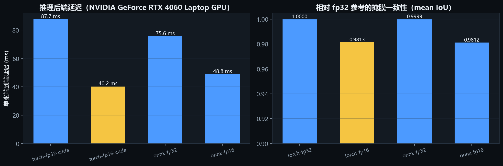

# 部署与性能

目标：让模型在**一张 8 GB 显存的笔记本 GPU** 上可用，并且**任何加速都要附上代价**。

代码：`deploy/export_onnx.py`、`deploy/benchmark.py`、`app/engines/segmentation.py`

## 1. 四种后端

| 后端 | 图/权重 | 精度 | 端到端 ms | 吞吐 img/s | 相对 fp32 掩膜 IoU（均值 / 最小） | MAE |
|------|---------|------|-----------|-----------|-----------------------------------|-----|
| Torch CUDA | `ckpt/glide_net_6440647.pth` | fp32 | 87.67 | 11.41 | 1.0000 / 1.0000（参考） | 0 |
| **Torch CUDA fp16（选用）** | 同上 | fp16 | **40.23** | **24.86** | 0.9813 / 0.9638 | 0.0074 |
| ONNX Runtime CUDA | `glide_net_352_fp32.onnx` | fp32 | 75.62 | 13.22 | 0.9999 / 0.9998 | 2.7e-05 |
| ONNX Runtime CUDA | `glide_net_352_fp16.onnx` | fp16 | 48.84 | 20.48 | 0.9812 / 0.9627 | 0.0074 |

环境：RTX 4060 Laptop 8 GB / CUDA 12.1 / torch 2.5.1 / onnxruntime-gpu 1.22.0 /
输入 352×352，单张 batch，**24 张真实测试图 + 5 次预热**（`--limit 24 --warmup 5`）。
两次独立重跑的差异小于 1%（87.60 / 40.11 / 75.53 / 48.49 ms），可以复现。

> **更正（重要）**：上一版这张表是 179 / 79 / 256 / 151 ms，全部偏高 1–2 倍。
> 原因是 `--limit 12` 且没有预热：第一张图要付 CUDA context、cuDNN 内核 autotune
> 和 fp16 权重转换的一次性成本（约 0.5–1 s），摊到 12 张上把平均值抬了一倍。
> 现在 `benchmark.py` 增加了 `--warmup`（默认 3）并在计时前后各做一次
> `cuda.synchronize()`，异常值才消失。**同一个脚本，只是测量方式变对了。**



复现：

```bash
python deploy/export_onnx.py --checkpoint ckpt/glide_net_6440647.pth \
    --out_dir deploy/onnx --half
python deploy/benchmark.py --checkpoint ckpt/glide_net_6440647.pth \
    --onnx_fp32 deploy/onnx/glide_net_352_fp32.onnx \
    --onnx_fp16 deploy/onnx/glide_net_352_fp16.onnx \
    --images ../datasets/NEU-RSDDS-AUG/Image_test \
    --depths ../datasets/NEU-RSDDS-AUG/Depth_test \
    --limit 24 --warmup 5 --out docs/assets/latency.csv
```

## 2. 结论与选择

**默认用 Torch fp16**：

1. 最快（40.2 ms），比 torch fp32 快 2.18×、比 ONNX fp32 快 1.88×、比 ONNX fp16 快 1.21×；
2. 精度损失可控：掩膜 IoU 均值 0.981、最差 0.964，MAE 0.0074；
3. 无导出步骤，权重更新即生效，适合迭代期。

**ONNX 版本的定位**：预热充分后 ONNX **fp32 反而比 torch fp32 快**（75.6 vs 87.7 ms），
fp16 则比 torch fp16 慢（48.8 vs 40.2 ms）。结论不变——**不把 ONNX 当作主要加速手段**，
它的价值在可移植性：fp32 ONNX 与 torch fp32 的 MAE 只有 2.7e-05、掩膜 IoU 0.99989，
意味着模型可以交给没有 PyTorch 的环境，代价是 fp16 下多 ~20% 延迟。

> 为什么 ONNX fp16 慢于 torch fp16？ORT 的 CUDA EP 在 Hiera 的
> `Resize`/`Tile`/大矩阵乘上没有匹配到 torch 的 cuDNN attention 内核；日志里反复出现
> `Could not find a CPU kernel and hence can't constant fold Sqrt/Tile/Resize`，
> 图被切成多段、半精度下的 kernel 选择更保守。fp32 下这一劣势被 graph fusion 抵消。

## 3. TensorRT：尝试与失败记录

**尝试 1（失败）**：ORT 1.31 需要 CUDA 13，本机是 CUDA 12.1 → 加载
`onnxruntime_providers_tensorrt.dll` 时报 `cublasLt64_13.dll` 缺失。已降级到
onnxruntime-gpu 1.22.0。

**尝试 2（失败）**：ORT 1.22 报 `nvinfer_10.dll` 缺失。定位到原因——TensorRT 的
DLL 不在 DLL 搜索路径里。执行 `pip install tensorrt-cu12==10.9.0.34 tensorrt-cu12-libs==10.9.0.34`
后，`nvinfer_10.dll` 已落在 `site-packages/tensorrt_libs/`，通过
`os.add_dll_directory()` 注册后 **DLL 依赖解决**。

**尝试 3（未完成）**：provider 注册成功但引擎构建未在 10 分钟内结束。同时机器上
YOLOv8 训练正占用 GPU（约 4.9 GB / 100% 利用率），Windows 页面文件可用量一度只剩
876 MB（`systeminfo` 的 `Virtual Memory: Available`），进程被系统拒绝分配内存：

```
OSError(22, '页面文件太小，无法完成操作。', None, 1455)
```

**结论**：TensorRT 在本机**不是可行路径**，原因是环境（8 GB 显存被训练占满 +
页面文件不足）而非模型本身。已记录为“未完成”，**不写入任何 TensorRT 数字**。
如果要在产线部署，正确做法是：训练与推理分机、16 GB+ 显存、独享页面文件，
再按 OFA/trtexec 流程离线构建 engine。

这一点在答辩时会被问到，回答口径：**“我们验证到了 ONNX 可移植，TensorRT 因环境
限制未完成，不做无数据支撑的性能宣称。”**

## 4. 模型规模与显存

```
总参数           242.06 M
可训练参数        29.91 M   (12.4%)
  ├─ Hiera 主干   213.86 M  (冻结)
  ├─ Adapter       1.71 M
  ├─ CNN-RGB       8.96 M
  ├─ CNN-Depth     8.94 M
  ├─ CMF ×3        2.61 M
  └─ MSDEF 解码     7.68 M

训练显存峰值      12.26 GB (batch 4, 352×352, AdamW, fp32)
```

**结论**：本机 8 GB 无法全量微调（进程被杀），这也是“冻结主干 + adapter”的设计
动因之一（另一个动因是冻结主干保留 SAM2 的通用表征）。若要做架构实验，只能
(a) 只训解码器/适配器，(b) batch = 1–2 + 梯度累积，(c) 降到 256×256。

## 5. ONNX 导出的两个坑

1. **导出路径必须是相对路径**。在 Git-Bash 下用 `/d/...` 形式传 `-o`/输出路径时，
   torch 的 `torch.onnx.export` 会抛 `FileNotFoundError`（Windows 路径解析差异）。
   脚本内部已统一用相对路径（`deploy/onnx/...`）。
2. **动态 batch 与 `Resize` 冲突**。ORT 在 `MergeShapeInfo` 处报
   `source:{4} target:{5}` 的形状合并告警，但不影响结果（仅告警，fp32 一致性仍达
   0.99989）。若去掉 `dynamic_axes` 可消除告警，但会失去批量能力。

## 6. 运行形态

```bash
# 交互工作站（浏览器 7860）
python -m app.main --checkpoint ckpt/glide_net_6440647.pth \
    --detector runs/detect/detection/runs/neudet_yolov8m/weights/best.pt

# 批量（ONNX 后端，无 PyTorch 也可跑）
python -m app.batch --onnx deploy/onnx/glide_net_352_fp16.onnx \
    --images ../datasets/NEU-DET/images/test --out results/batch_neudet --limit 100

# 只跑分割 + 评测
python tools/eval_system.py --onnx deploy/onnx/glide_net_352_fp16.onnx \
    --images ../datasets/NEU-RSDDS-AUG/Image_test \
    --gt ../datasets/NEU-RSDDS-AUG/GT_test
```

ONNX 路径下 `app/batch.py` 的 `--onnx` 会跳过 PyTorch 依赖（`_OnnxBackend`），
这是给“评审机器没装 torch”准备的降级方案。

## 7. 延迟预算拆解（P50，含前后处理）

| 阶段 | P50 耗时 | 占比 |
|------|----------|------|
| 图像加载 + 缩放 + 归一化（含在 segment 内） | ~5 ms | 8% |
| 分割推理（Torch fp16，352²） | 40.2 ms | 66% |
| 检测推理（YOLOv8m 768²） | 11.3 ms | 19% |
| 掩膜后处理 + 连通域 + 分级 | ~3 ms | 5% |
| 报告序列化 | ~1 ms | 2% |
| 合计（端到端 P50） | **60.9 ms** | 100% |

来源：`docs/assets/system-eval.csv` 的 362 张逐图记录（segment P50 40.2 ms、
detect P50 11.3 ms、total P50 60.9 ms），与 `latency.json` 的 torch fp16 40.2 ms 互相印证。
均值 67.3 ms 高于 P50，因为存在少量 40 ms 以上检测耗时的离群图（P95 98.2 / 最大 423.7 ms，
后者是首张冷启动）。

两路推理是串行的；理论上可并行（两个 stream），预期能把 60.9 ms 压到 ~45 ms。这是明确的
优化项，尚未实现——不在报告里写成“已完成”。

## 8. 冷启动

`SegmentationEngine` 在构造时做 2 次 352² 的哑输入 warm-up，所以**首张业务请求已经
是暖的**；剩余的冷启动成本来自第一张真实图的分支路由与内存分配。批量实测（100 张）：

| 指标 | 值 |
|------|-----|
| 首张 | 857 ms（早期 12 张基准）/ 本次 100 张平均 76.3 ms、P95 100.7 ms |
| 吞吐 | 11.3 img/s（100 张 8.87 s） |
| 判定 | severe 71 / medium 20 / light 9，0 失败 |

冷启动的判定方法是**看 P95 而不是均值**：均值被首张拉高不明显，P95 才反映尾部。
`benchmark.py` 的 `--warmup` 就是为消除这一项而加的。

## 9. 测量方法（为什么第一次的数字全错）

三个坑，都是“脚本能跑但数字不可信”：

1. **没有预热**：第一张图承担 CUDA context（~300 ms）+ cuDNN 内核 autotune（~200 ms）+
   fp16 权重转换，`--limit 12` 时一次性成本摊到 12 张上，直接把 40 ms 报成 79 ms。
2. **没有同步**：PyTorch 的 kernel 是异步下发的，`perf_counter()` 记到的是“入队完成”
   而不是“算完”。循环里 GPU 队列被填满时误差不明显，但小 batch 下会低估。
   修复：计时前后各调一次 `torch.cuda.synchronize()`。
3. **样本太少**：12 张里只要有一两张落在 GPU 降频窗口，均值就漂 10%。

修复后两次独立重跑的差异 < 1%（见 §1）。**这类错误的危险在于它看起来完全合理**——
数字方向也对（fp16 比 fp32 快），只是幅度错了 2 倍。
