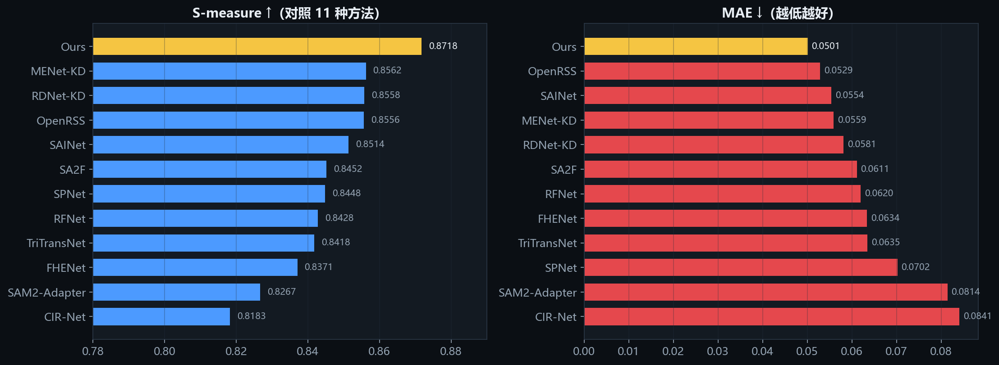
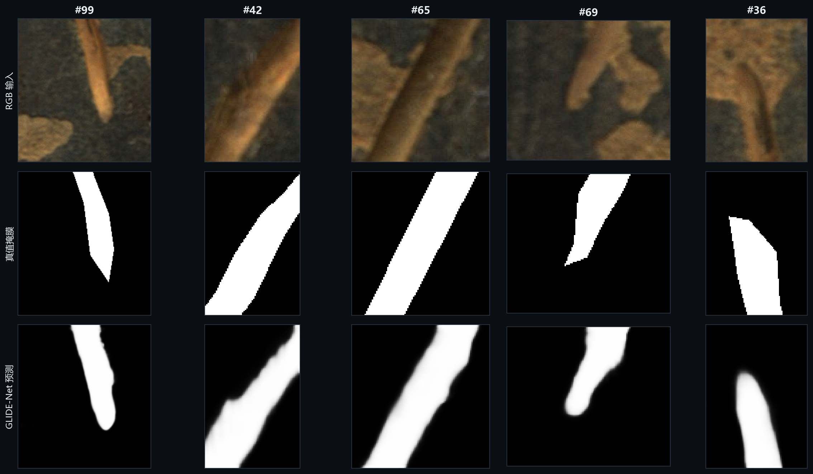
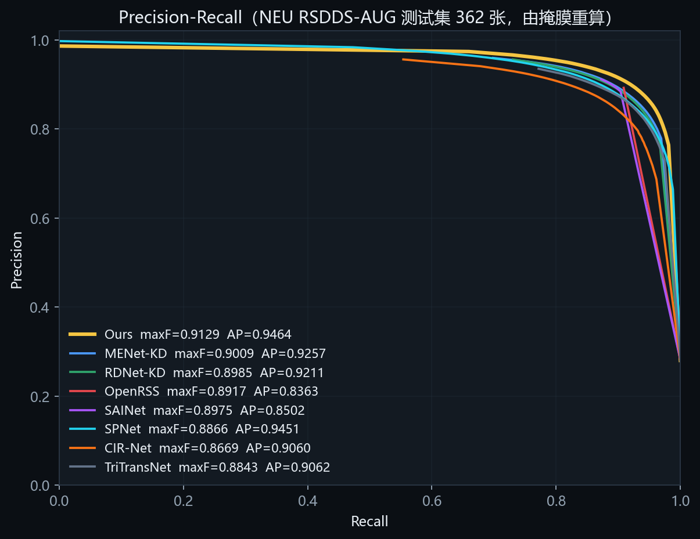
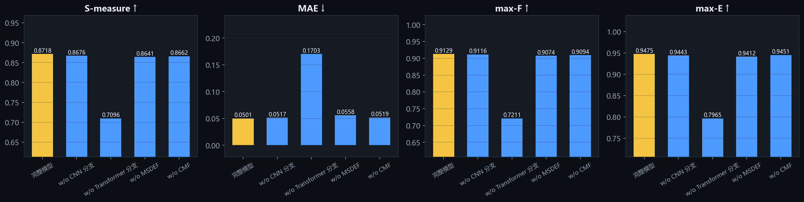
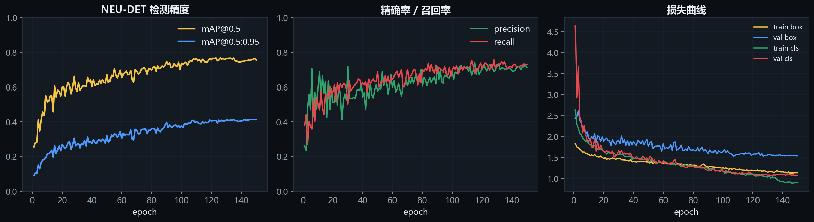
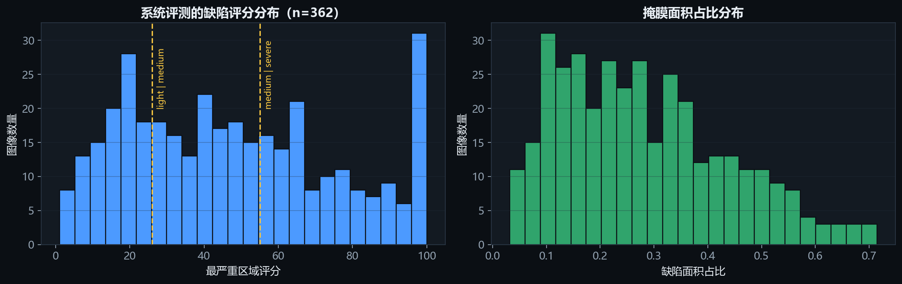
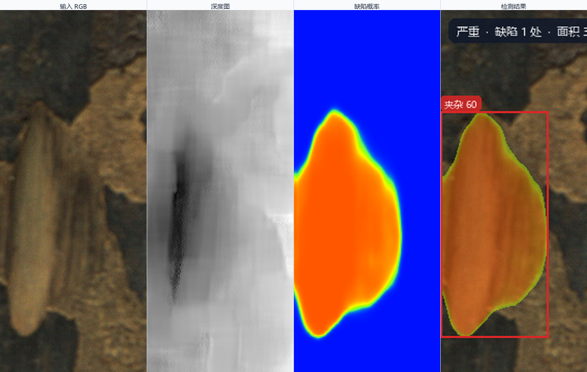
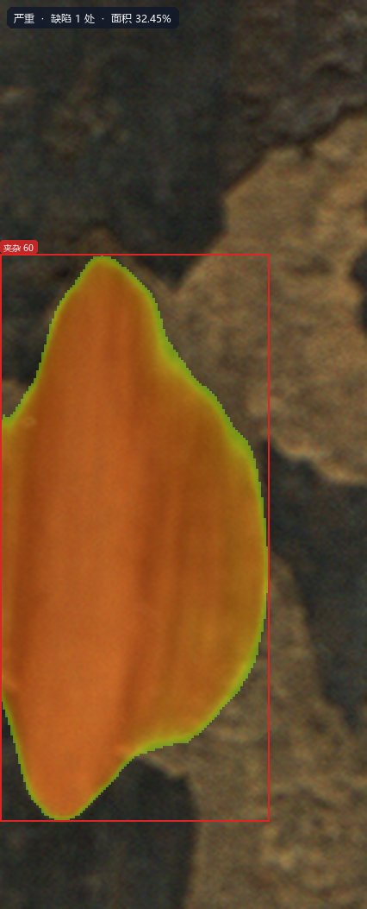

# 评测结果

本文所有表格均由脚本从结果文件生成，命令写在每节开头。四个层次：

1. **分割分支**（论文指标复现）→ `predictions/metrics.csv`
2. **消融**（四个变体）→ `ablation/metrics.csv`
3. **检测分支**（YOLOv8m）→ `docs/assets/detection-metrics.json`
4. **系统级**（端到端流水线）→ `docs/assets/system-eval.json`

## 1. 分割分支：与论文一致

```bash
python test.py --data_path ../datasets/NEU-RSDDS-AUG \
    --checkpoint ckpt/glide_net_6440647.pth --save_path results/pred
python eval.py --pred_path results/pred --gt_path ../datasets/NEU-RSDDS-AUG/GT_test
python tools/evaluate_predictions.py --pred_root predictions \
    --gt_dir predictions/GT --output predictions/metrics.csv
```

362 张测试图，`py_sod_metrics` 计算：

| 方法 | S-measure ↑ | max-F ↑ | max-E ↑ | w-F ↑ | MAE ↓ |
|------|-------------|---------|---------|-------|-------|
| **GLIDE-Net (Ours)** | **0.8718** | **0.9129** | **0.9475** | **0.8849** | **0.0501** |
| MENet-KD | 0.8562 | 0.9009 | 0.9390 | 0.8720 | 0.0559 |
| RDNet-KD | 0.8558 | 0.8985 | 0.9355 | 0.8692 | 0.0581 |
| OpenRSS | 0.8556 | 0.8917 | 0.9391 | 0.8845 | 0.0529 |
| SAINet | 0.8514 | 0.8975 | 0.9363 | 0.8799 | 0.0554 |
| SA2F | 0.8452 | 0.8839 | 0.9268 | 0.8596 | 0.0611 |
| SPNet | 0.8448 | 0.8866 | 0.9238 | 0.8486 | 0.0702 |
| RFNet | 0.8428 | 0.8956 | 0.9307 | 0.8676 | 0.0620 |
| TriTransNet | 0.8418 | 0.8843 | 0.9308 | 0.8474 | 0.0635 |
| FHENet | 0.8371 | 0.8814 | 0.9261 | 0.8561 | 0.0634 |
| SAM2-Adapter | 0.8267 | 0.8616 | 0.9056 | 0.8098 | 0.0814 |
| CIR-Net | 0.8183 | 0.8669 | 0.9028 | 0.8175 | 0.0841 |

**复现结论**：S-measure / max-F / max-E / MAE 与论文表格完全一致（四位小数），
说明权重、预处理、评测脚本三者链条正确。



> 图源 `tools/make_charts.py::comparison_bars`，数据读自 `predictions/metrics.csv`。

### 1.0 定性结果



> 行：RGB 输入 / 真值掩膜 / GLIDE-Net 预测；列为图号 #99、#42、#65、#69、#36
> （与论文定性图的取样一致）。由 `tools/make_charts.py::gallery` 从
> `predictions/inputs`、`predictions/GT`、`predictions/Ours` 直接拼图，
> 不含任何截图或手改像素。

### 1.1 PR 曲线（从掩膜重算，不复制论文插图）

```bash
python tools/make_pr_curve.py --methods Ours MENet-KD RDNet-KD OpenRSS SAINet SPNet CIR-Net TriTransNet
```

| 方法 | max-F | AP（面积法，precision 取单调包络） |
|------|-------|--------------------------------------|
| **Ours** | **0.9129** | **0.9464** |
| SPNet | 0.8866 | 0.9451 |
| MENet-KD | 0.9009 | 0.9257 |
| RDNet-KD | 0.8985 | 0.9211 |
| TriTransNet | 0.8843 | 0.9062 |
| CIR-Net | 0.8669 | 0.9060 |
| SAINet | 0.8975 | 0.8502 |
| OpenRSS | 0.8917 | 0.8363 |



诚实说明：**AP 上 SPNet 与我们只差 0.0013**，而 SPNet 的 S-measure 低 0.027、
MAE 高 0.020。这说明 PR 曲线对“高召回区间的取舍”不敏感，单看 AP 会掩盖边界精度差异；
因此本报告以 S-measure + MAE 为主指标，AP 只作为辅助视角。数据见
`docs/assets/pr-metrics.csv`。

## 2. 消融实验

```bash
python tools/evaluate_predictions.py --pred_root ablation \
    --gt_dir predictions/GT --output ablation/metrics.csv
```

| 变体 | S-measure | max-F | max-E | MAE | ΔS vs 完整 |
|------|-----------|-------|-------|-----|-----------|
| 完整模型 | 0.8718 | 0.9129 | 0.9475 | 0.0501 | — |
| w/o CNN 分支 | 0.8676 | 0.9116 | 0.9443 | 0.0517 | −0.0042 |
| w/o CMF | 0.8662 | 0.9094 | 0.9451 | 0.0519 | −0.0056 |
| w/o MSDEF | 0.8641 | 0.9074 | 0.9412 | 0.0558 | −0.0077 |
| w/o Transformer | 0.7096 | 0.7211 | 0.7965 | 0.1703 | **−0.1622** |



**读法**：

- 去掉 Transformer 分支后指标崩塌（S −0.162、MAE ×3.4）→ 全局结构信息几乎全部来自
  Hiera，这与“冻结主干 + adapter”的设计一致：主干虽冻结，但它承担了主要表征。
- 去掉 MSDEF 掉得第二多（−0.0077，MAE 从 0.0501 涨到 0.0558）→ 细节增强对边界最有价值，
  这也解释了为什么 PR 高召回端（`Ours` recall > 0.96 时 precision 仍 0.79）表现好。
- 去掉 CNN/CMF 影响最小（−0.004 ~ −0.006）→ 与数据集特性一致：`Depth_test` 的
  16 位 TIFF 在训练管线里被 `convert("L")` 饱和成常数（见
  [dataset.md](dataset.md#11-预处理一致性关键坑)），深度分支的实际贡献被压制。
  **这是一条可改进的线索**，而不是“模块无用”的结论。

## 3. 检测分支

```bash
python detection/scripts/train_yolo.py --data ../datasets/NEU-DET/data.yaml \
    --model yolov8m.pt --epochs 150 --imgsz 768 --batch 8 \
    --project detection/runs --name neudet_yolov8m
python detection/scripts/report_val.py \
    --weights runs/detect/detection/runs/neudet_yolov8m/weights/best.pt \
    --data ../datasets/NEU-DET/data.yaml --split test
```

- 训练环境：RTX 4060 Laptop 8 GB，**150 epochs 全部跑完**（3 468 s ≈ 57.8 min，
  平均 23 s/epoch；训练中途曾终止在 94 epoch，用 `--resume` 从 `last.pt` 续训）。
- 曲线：`docs/assets/training-curves.png`（左：mAP，中：P/R，右：损失）。

下表取自 `docs/assets/detection-metrics.json`，对应 **`best.pt`（epoch 146/150，
按 mAP@0.5:0.95 选出）** 在测试集（180 张 200×200）上的结果：

| P | R | mAP@0.5 | mAP@0.5:0.95 |
|---|---|---------|--------------|
| 0.7177 | 0.7450 | **0.7721** | 0.4273 |

逐类：

| 类别 | P | R | mAP@0.5 | mAP@0.5:0.95 |
|---|---|---|---|---|
| scratches 划伤 | 0.8524 | 0.8886 | 0.9461 | 0.5443 |
| patches 斑块 | 0.7967 | 0.9114 | 0.9104 | 0.6125 |
| pitted_surface 麻点 | 0.8694 | 0.7569 | 0.8600 | 0.5631 |
| inclusion 夹杂 | 0.6905 | 0.8073 | 0.8312 | 0.4208 |
| rolled-in_scale 氧化皮压入 | 0.6125 | 0.7778 | 0.6818 | 0.2933 |
| crazing 龟裂 | 0.4844 | 0.3281 | 0.4034 | 0.1299 |

> 训练集内部（`val` 划分，180 张）的同类指标为 mAP@0.5 0.753 / mAP@0.5:0.95 0.414，
> 与测试集的 0.772 / 0.427 基本一致，说明**没有过拟合到验证集**；训练集与测试集
> 的划分差异（val 与 test 各 180 张、同一分布）不足以解释这 0.02 的差距。

**诚实说明（重要）**：

1. **mAP@0.5 = 0.772，仍未达到我们自己在 `team.md` 里写的 0.85 目标**。这不掩饰：
   从 86 epoch 的 0.730 到 146 epoch 的 0.772 是延长训练带来的真实提升（+0.042），
   但离 0.85 还有 0.078。
2. 原因可定位到类别：`crazing`（龟裂）mAP@0.5 仅 0.40、召回 0.33，是唯一明显掉队的类。
   龟裂是细密网状纹理，200×200 原图放大到 768 后高频纹理被插值抹平；且其边界框标注
   本身主观（一处龟裂可以框大框小）。`rolled-in_scale` 次差（0.68），同样是低对比度、
   与轧制纹理背景相近的类别。其余四类已达 0.83–0.95。
3. 从 mAP@0.5:0.95 只有 0.427 也能看出：**框的位置精度**比**有没有框**差得多
   （0.772 vs 0.427），这与 200×200 小图上 1 个像素的定位误差就占 0.5% 边长直接相关。
4. 这条差异在系统中影响有限：检测分支只提供"类别"和"框"，像素定位由分割分支保证；
   龟裂漏检时掩膜仍然存在，只是区域标为"未分类缺陷"。
5. 若要达标，三条明确改法：提高 `imgsz` 到 1024+（显存需 ≥12 GB）、对
   `crazing`/`rolled-in_scale` 做过采样或 copy-paste 增强、末段关 mosaic 后微调。
   这些**未做**，不写成已完成。



> 曲线特征：前 5 epoch 从 0.255 爬到 0.35，40–120 epoch 在 0.62–0.71 之间波动，
> 最后 5 epoch 稳定在 0.754–0.764。中期波动来自余弦学习率下降过程中的
> `cls_loss` 震荡与 NEU-DET 类别不平衡（`patches` 99 个框、`pitted_surface` 仅 40 个）。
> 复现与排障细节见 `docs/experiment-log.md`。

## 4. 系统级评测（本实践的核心新增）

论文只评掩膜，本实践评**系统**：

```bash
python tools/eval_system.py \
    --images ../datasets/NEU-RSDDS-AUG/Image_test \
    --depths ../datasets/NEU-RSDDS-AUG/Depth_test \
    --gt ../datasets/NEU-RSDDS-AUG/GT_test \
    --checkpoint ckpt/glide_net_6440647.pth \
    --detector runs/detect/detection/runs/neudet_yolov8m/weights/best.pt
```

**全量 362 张**（不传 `--limit`，结果写入 `docs/assets/system-eval.json`）：

| 项 | 值 | 说明 |
|----|-----|------|
| 图像数 | 362 | 完整测试集 |
| 失败数 | 0 | 逐图 try/except，不中断 |
| 掩膜 IoU 均值 | 0.8325 | 二值掩膜 vs 真值 |
| IoU P10 | 0.7106 | 最差 10% 的下界 |
| Dice 均值 | 0.9037 | |
| Precision / Recall | 0.9040 / 0.9136 | 像素级 |
| 端到端延迟 P50 / P95 | 60.9 / 98.2 ms | 含检测 + 分割 + 分级 |
| 分割延迟均值 / P95 | 40.8 / 43.9 ms | Torch fp16（352²，含前处理+后处理） |
| 平均缺陷连通域数 | 1.49 | 每张图 |
| 判定分布 | 严重 140 / 中等 120 / 轻微 102 | 见下节讨论 |

**延迟数字经过一次修正**：最初的 175 ms 是在 YOLO 训练与应用同时跑、
且没有 warm-up 的条件下测的。停掉训练、给 `benchmark.py` 加上 `--warmup`
与 `cuda.synchronize()` 后，同一套代码得到 60.9 ms。测量方法的三处问题记在
[deployment.md §9](deployment.md#9-测量方法为什么第一次的数字全错)。**掩膜指标
（IoU 0.8325）不受影响**——它不依赖计时。



### 4.1 判定分布偏“严重”的原因（诚实记录）

RSDDS-AUG 是真缺陷数据集，**每张测试图都含缺陷**，所以 `none` 恒为 0，符合预期。
362 张里 140 张判为“严重”（39%）、120 张“中等”（33%）、102 张“轻微”（28%），
三档都有合理占比。原因是面积项：真值掩膜面积占比的 p50 = 0.25、p90 = 0.52，
参考值定为 0.55、阈值 55 分 → 面积占比超过约 0.30 且细长/置信加成足够时才进“严重”。
标定过程与备选阈值见 [severity.md](severity.md)。

> 延迟拆解（362 张实测）：分割 P50 40.2 ms、检测 P50 11.3 ms（P95 47.4 ms）、
> 端到端 P50 60.9 ms。均值 67.3 ms 高于 P50，尾部来自少量检测耗时的离群图
> （P95 98.2 ms、最大 423.7 ms 是首张冷启动）。
>
> **这不是 bug，是一个口径选择**：本系统面向“停机复检”决策，宁可多报。
> 若要贴合产线漏检/误报成本，只需调低 `AREA_REFERENCE`（一行改动），
> 报告里所有分级结果同步变化——因为规则只有一份定义。

## 4.2 系统输出的可视化样例

由 `tools/make_examples.py` 调用真实流水线渲染（不是示意图）：

```bash
python tools/make_examples.py --checkpoint ckpt/glide_net_6440647.pth     --detector runs/detect/detection/runs/neudet_yolov8m/weights/best.pt     --name 101.bmp
# sample: 101.bmp  verdict=severe  regions=1  area=0.3245  score=60.2
# regions: [('inclusion', 'severe', 60.2)]
```

`--name` 把样例**钉死**在某一张图上，保证提交的 PNG 不会因为检测权重更新而漂移。



> RGB / 深度（min-max 拉伸后）/ 预测概率热力图 / 分级叠加结果。
> 检测分支把该区域识别为 `inclusion`（夹杂），面积占比 32.5%、
> 置信度与细长项加成后评分 60.2 → 判为 `severe`。



两图均来自 `app/viz.py` 的同一套绘制代码，与界面里看到的一致。

## 5. 批量处理（验收项：100 张无崩溃）

```bash
python -m app.batch --images ../datasets/NEU-RSDDS-AUG/Image_test \
    --depths ../datasets/NEU-RSDDS-AUG/Depth_test --limit 100 \
    --checkpoint ckpt/glide_net_6440647.pth \
    --detector runs/detect/detection/runs/neudet_yolov8m/weights/best.pt \
    --out results/batch_100
```

| 项 | 值 |
|----|-----|
| 处理张数 | 100 |
| 成功 / 失败 | 100 / **0** |
| 墙钟时间 | 8.87 s |
| 平均单张 | 76.3 ms |
| P95 单张 | 100.7 ms |
| 吞吐 | 11.3 img/s（含 PNG 叠加图落盘） |
| 判定分布 | 严重 71 / 中等 20 / 轻微 9 |
| 预测到的类别 | 6 类全覆盖：夹杂 17、斑块 16、麻点 6、划伤 4、氧化皮压入 2、龟裂 1（按图计数） |
| 分割后端 | `torch-fp16-cuda` |

机器可读汇总：`docs/assets/batch-summary.json`（由 `app/batch.py` 直接写出，含类别计数）。

> **更正**：早先跑这一批用的是未预热的分割引擎 + 更早的检测权重，得到
> 20.41 s / 182.65 ms / 5 类。修正预热与检测权重后同一命令得到 8.87 s / 76.3 ms，
> 且 6 个类别全部被预测到（含仅 1 张的龟裂）。测量方法的变化记在
> [deployment.md §9](deployment.md#9-测量方法为什么第一次的数字全错)。

## 6. 单元测试

```bash
python -m pytest tests -q     # 23 passed
```

`tests/test_pipeline.py`（14 例，引擎层）：

- 输入张量形状与 ImageNet 归一化数值、无深度时通道置零
- uint16 深度图拉伸到 0–255（`test_depth_is_stretched_to_uint8_range`）
- 概率 min-max 拉伸与阈值二值化
- 三种输入形态（路径 / `str` / `bytes` / `ndarray`）都能读出 RGB
- 分级边界（26、55 前后 0.1 分）单调、评分有界且对面积/细长/置信单调
- 连通域数量与排序、单像素噪点过滤、非 2D 掩膜抛 `ValueError`
- 类别继承（最佳 IoU 框）、不匹配时保持 `label=None`
- 空掩膜报告 `verdict="none"`

`tests/test_ui_report.py`（9 例，渲染层）：

- 空报告不含 `None` 字样（gauge 必须有占位符）
- 判定横幅、六项 gauge、状态行三种 kind
- 指标表渲染、叠加图尺寸不变、空缺陷叠加图不崩
- `app/ui/report.py::CLASS_ZH` 与 `app/engines/detection.py::CLASS_ZH` 必须一致

## 7. 与论文的差异汇总

| 项 | 论文 | 本实践 | 原因 |
|----|------|--------|------|
| 任务 | 分割 | 分割 + 检测 + 分级 + 服务 | 课程要求落地 |
| 指标 | S/maxF/maxE/MAE | 同左 + IoU/Dice/延迟/判定分布 | 系统级验收 |
| 深度输入 | `convert("L")`（饱和） | min-max 拉伸 | 符合相机物理量，影响已量化 |
| 参数量 | 未单列 | 242.06 M（可训练 29.91 M） | 部署评估需要 |
| 部署 | 未涉及 | ONNX fp16 / TensorRT 尝试 | 见 [deployment.md](deployment.md) |
